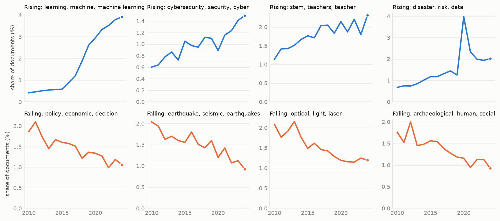
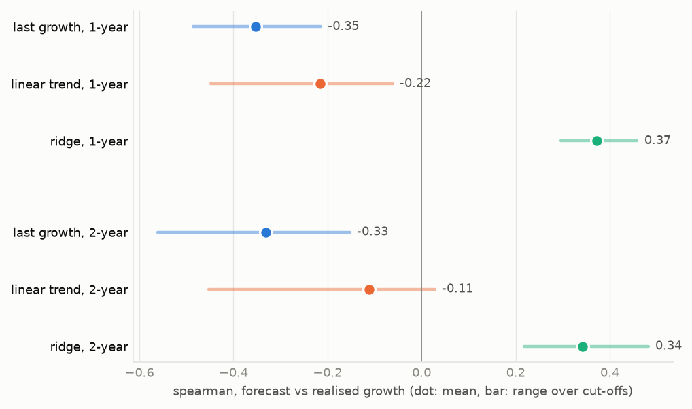

# Research and Innovation Monitor

Hybrid retrieval, citation-grounded generation and quantitative trend analysis over
scientific literature, patents and public research grants.

The system answers three kinds of question about a body of research: which documents
are relevant to a technical query, what the retrieved evidence supports, and which
research themes are growing. Each component is measured against simpler baselines on
public benchmarks. Every number below is read from a result file that records the
configuration, dataset revision, model revision, seed, device and Git commit of the
run that produced it.

## Contents

- [Motivation](#motivation)
- [Research questions](#research-questions)
- [Key findings](#key-findings)
- [Architecture](#architecture)
- [Data](#data)
- [Methods](#methods)
- [Experimental protocol](#experimental-protocol)
- [Results](#results)
- [Limitations](#limitations)
- [Reproducibility](#reproducibility)
- [Installation](#installation)
- [Usage](#usage)
- [API](#api)
- [Dashboard](#dashboard)
- [Repository structure](#repository-structure)
- [References](#references)

## Motivation

Research offices, funders and R&D teams need to follow what is being published,
patented and funded in a field. Systems built for this often chain a language model
to a vector database and report no measurement of whether retrieval is good, whether
generated statements are supported, or whether a "trend" is more than noise.

This project treats each of those as an empirical question. Retrieval methods are
compared with significance tests on benchmarks with relevance judgments. Generated
answers are scored sentence by sentence against the passages they cite. Trend
forecasts are backtested against what happened next.

## Research questions

| | Question |
|---|---|
| RQ1 | Does hybrid lexical and dense retrieval outperform BM25-only and dense-only retrieval on scientific queries, and does the answer change for patents? |
| RQ2 | How much ranking quality does cross-encoder reranking add per unit of latency? |
| RQ3 | Does query decomposition improve retrieval for multi-aspect queries, and does it harm simple ones? |
| RQ4 | What fraction of generated sentences is supported by the passages they cite, and does the system abstain when the evidence is withheld? |
| RQ5 | Does topic growth measured up to year T predict growth in the following years better than persistence and count-based baselines? |
| RQ6 | Do topic shares in research grants lead or lag topic shares in papers? (exploratory) |

## Key findings

<!-- findings:start -->
From the runs reported under [Results](#results). All are local runs with small models;
the larger-model runs are listed there as PENDING.

1. **Hybrid retrieval beat BM25 on all four benchmarks, and beat the best dense
   encoder on three** (nDCG@10, tuned convex fusion). LitSearch: 0.533 against 0.437
   for BM25 and 0.450 for dense. SciFact: 0.733 against 0.683 and 0.706. Patents
   (DAPFAM): 0.228 against 0.193 and 0.218. On SCIDOCS the hybrid (0.210) was not
   distinguishable from the best dense encoder (0.208, p = 0.13).
2. **A small dense encoder alone did not reliably beat a tuned BM25.** The difference
   was not significant on LitSearch (p = 0.52) or SciFact (p = 0.34).
3. **Tuned score fusion was at least as good as reciprocal rank fusion**:
   significantly better on LitSearch and SCIDOCS, indistinguishable on SciFact and
   DAPFAM.
4. **Patent retrieval across technology classes largely failed for every method.**
   nDCG@10 was about 0.24 when query and target share an IPC class and about 0.02
   when they do not.
5. **The small MS MARCO cross-encoder made rankings worse on every benchmark and at
   every depth, while multiplying latency.** On LitSearch nDCG@10 fell from 0.533 to
   0.511 at depth 10 and 0.487 at depth 100, with median latency rising from 17 ms
   to 78 ms and 452 ms. The decrease at the selected depth was significant after
   correction on SCIDOCS and DAPFAM, and not on LitSearch or SciFact.
6. **Query decomposition with a 3B model did not help.** On multi-aspect queries
   (DORIS-MAE) no condition differed significantly from no decomposition, including
   the dataset authors' own aspects. On LitSearch it lowered nDCG@10 from 0.511 to
   0.411 (p < 0.001).
7. **About half of the sentences written by a 3B model were not supported by the
   passages they cited**, according to an entailment judge with a measured balanced
   accuracy of 0.76. Citation recall was 0.52 (95% CI 0.44 to 0.61). With the gold
   evidence removed, the model still made claims in 51 of 100 answers. The same judge
   scored verbatim extracts at 0.89, which bounds how much of the gap is judge error.
8. **No router was reliable on paraphrased requests.** A rule-based router scored
   1.00 on templated requests written by its author and 0.56 on model-written
   paraphrases; a 3B model scored 0.49, rarely missing a needed tool but calling an
   unneeded one in about half of the requests.
9. **Extrapolating recent topic growth predicted the wrong direction.** On NSF awards,
   the latest one-year growth and a five-year linear trend both correlated
   *negatively* with realised growth (Spearman -0.35 and -0.22 at one year), and both
   had larger errors than assuming no change. A ridge model on trend features reached
   a Spearman of 0.37 and a small but significant error reduction over no change.
<!-- findings:end -->

## Architecture

```
 request
    │
    ▼
 router ───────────────┬──────────────────┬──────────────────┐
 (rules | classifier   │                  │                  │
  | language model)    ▼                  ▼                  ▼
                 literature search   patent search     trend statistics
                 grant search             │            (precomputed tables)
                       │                  │                  │
                       ▼                  ▼                  │
                 BM25  +  dense encoder (exact search)       │
                       │                                     │
                       ▼                                     │
                 fusion: reciprocal rank | convex            │
                       │                                     │
                       ▼                                     │
                 cross-encoder reranker (optional)           │
                       │                                     │
                       ▼                                     │
                 numbered passages → language model          │
                       │                                     │
                       ▼                                     ▼
                 sentences with citations  +  statistics computed in Python
                       │
                       ▼
                 citation check: markers resolved, support judged by entailment
                       │
                       ▼
                 FastAPI  →  Streamlit dashboard
```

The language model writes prose over numbered evidence and nothing else. Routing has
a rule-based baseline, retrieval and ranking are deterministic, and every statistic
in a report is computed in Python and returned verbatim. Design decisions, the
baseline each is measured against, and the alternatives considered are in
[docs/design.md](docs/design.md).

| Component | Implemented | Evaluated |
|---|---|---|
| BM25, dense retrieval, RRF and convex fusion | yes | yes, four benchmarks |
| Cross-encoder reranking | yes | yes, one small reranker; a larger one is PENDING |
| Citation-grounded generation and attribution scoring | yes | yes, at development scale with a 3B model; 7B run PENDING |
| Entailment judge | yes | yes, against human labels |
| Tool routing (rules, classifier, language model) | yes | yes |
| Query decomposition | yes | yes, with a 3B model; 7B run PENDING |
| Topic model, trend tests, growth backtest | yes | yes, on NSF awards; arXiv PENDING |
| Grants and papers lead-lag test (exploratory) | yes | PENDING (needs the arXiv corpus) |
| Chunk-size ablation on full text | yes | PENDING |
| API and dashboard | yes | functional tests only |

Not included: startup and venture-investment data. No open, redistributable source of
funding rounds exists, so that part of the original problem is left as a possible
extension rather than approximated. Live patent monitoring is also not included: the
PatentsView API was retired in March 2026, and patents are used here as a fixed
retrieval benchmark.

## Data

No dataset is stored in this repository. Each is downloaded at a pinned revision and
converted to a common schema with a manifest (source, revision, licence, row counts,
SHA-256 of every file).

| Dataset | Role | Size | Licence |
|---|---|---|---|
| [LitSearch](https://huggingface.co/datasets/princeton-nlp/LitSearch) | Literature search | 597 queries, 64,183 ML and NLP papers | MIT on the code repository; the dataset card states none |
| [SciFact](https://huggingface.co/datasets/BeIR/scifact) (BEIR) | Claim-to-evidence retrieval; generation | 1,109 judged claims, 5,183 abstracts | CC BY-SA 4.0 |
| [SCIDOCS](https://huggingface.co/datasets/BeIR/scidocs) (BEIR) | Citation prediction | 1,000 queries, 25,657 papers | CC BY-SA 4.0 |
| [DAPFAM](https://huggingface.co/datasets/datalyes/DAPFAM_patent) | Patent prior art | 1,247 query families, 45,336 target families | CC BY-NC-SA 4.0, evaluation only |
| [DORIS-MAE](https://doi.org/10.5281/zenodo.8299749) | Multi-aspect queries | 100 queries, pools of about 100 abstracts | CC BY-NC 4.0, evaluation only |
| [SciFact claims](https://github.com/allenai/scifact) | Human labels for the entailment judge | 919 train and 340 dev claim-abstract pairs | CC BY 4.0 (claims), ODC-By 1.0 (abstracts) |
| [NSF Awards API](https://api.nsf.gov/services/v1/awards.json) | Grants: trend analysis | 175,409 awards, 2010 to 2024 | Public domain |
| [arXiv metadata](https://www.kaggle.com/datasets/Cornell-University/arxiv) | Papers: trend analysis | PENDING | CC0 |

Queries are split into dev and test by a hash of the query ID (30% dev), except
SciFact, which keeps its native split. Investigator names and contact details that
the NSF API returns are discarded when records are parsed. See [data/README.md](data/README.md).

## Methods

### Retrieval

- **BM25** with the Lucene form of the inverse document frequency, over a sparse
  term-count matrix. k1 and b are selected on dev queries from a 5 by 4 grid.
- **Dense retrieval** with a bi-encoder and exact inner-product search. Model
  revision, prefixes, normalisation and truncation are recorded with each run.
- **Reciprocal rank fusion**: score(d) = Σ 1 / (k + rank_i(d)), with k selected on dev.
- **Convex fusion**: score(d) = α · dense(d) + (1 − α) · lexical(d) after per-query
  min-max normalisation, with α selected on dev.
- **Reranking** of the fused candidates with a cross-encoder, at depths 10 to 100.

### Grounded generation

The top passages are numbered and passed to the model with the instruction to cite a
passage after every sentence and to reply `INSUFFICIENT EVIDENCE` when the passages do
not contain the answer. The answer is split into sentences; each citation marker is
resolved to a passage, and markers that match nothing are counted. Following ALCE,
*citation recall* is the share of sentences entailed by the passages they cite and
*citation precision* the share of citations that are needed for that entailment.

Entailment is decided by an NLI model whose threshold is selected on SciFact train
claims and whose agreement with human labels is reported on SciFact dev claims. An
extractive generator that copies sentences from the passages serves as a model-free
reference.

### Trend analysis

Documents are embedded, reduced with PCA, re-normalised and clustered with k-means;
unseen documents are assigned to the nearest centroid. For each topic the yearly
share of documents is tested for a monotone trend with the Mann-Kendall test, sized
with the Theil-Sen slope, and corrected over topics by Benjamini-Hochberg.

Forecasting is evaluated by rolling-origin backtest. For each cut-off year T, topics
are fitted on documents dated T or earlier, and the log growth of each topic's share
over the next one and two years is forecast by:

- *persistence*: no change;
- *last growth*: the latest one-year growth continues (for ranking topics this is
  identical to growth in raw counts);
- *linear trend*: Theil-Sen slope of the log share over five years;
- *ridge*: regression on trend features, trained only on earlier cut-offs whose
  outcomes were already known at T.

### Routing and decomposition

Routing is multi-label classification over four tools (literature, patents, grants,
trends). A regular-expression router is the baseline for an embedding classifier and
a language model. Because the rule patterns and the task templates share an author,
routers are also scored on paraphrases of the test requests written by a model.

Decomposition splits a query into sub-queries, retrieves each with the same pipeline
as the original, and fuses the lists (including the original query's) by reciprocal
rank. Conditions: none, one sub-query per sentence, model-written sub-queries, and on
DORIS-MAE the dataset authors' own aspects as an upper reference.

## Experimental protocol

- **Tuning uses dev queries only.** BM25 parameters, the hybrid encoder, the RRF
  constant, the fusion weight, which fusion feeds the reranker and the rerank depth
  are all selected on dev. Test queries are scored once afterwards. A unit test
  alters the test judgments and asserts that no selection changes.
- **Paired tests.** Systems are compared per query with a Fisher randomisation test
  (10,000 permutations), Holm-corrected within each pre-specified family.
- **Intervals.** 95% percentile bootstrap over queries (10,000 resamples).
- **Latency.** Measured one query at a time on the device named in the run record.
- **No temporal leakage.** Topic models in the backtest never see documents after
  the cut-off; a unit test checks the mask.
- **Fixed choices are fixed in advance.** The number of topics is set in the config;
  results at other values are reported as sensitivity.

## Results

All local runs used an Apple M3 Pro (MPS). The results section below is generated by
`scripts/make_results_tables.py` from `results/*/summary.json`.

<!-- results:start -->

### RQ1 and RQ2: retrieval

**LitSearch**: 64,183 documents, 424 test and 173 dev queries. Run [`retrieval_litsearch-20261006T235655Z-0c6fc84-c8d522aa`](results/retrieval_litsearch/run.json), commit `0c6fc84`, device `mps`.

| System | ndcg@10 | 95% CI | Recall@20 | Recall@100 | MRR@10 | Median latency (ms) |
|---|---:|---|---:|---:|---:|---:|
| bm25 | 0.437 | [0.396, 0.479] | 0.635 | 0.771 | 0.399 | 0.7 |
| dense:minilm-l6 | 0.366 | [0.328, 0.405] | 0.608 | 0.750 | 0.324 | n/a |
| dense:bge-small | 0.450 | [0.410, 0.490] | 0.666 | 0.792 | 0.409 | 16.3 |
| hybrid (RRF) | 0.511 | [0.471, 0.552] | 0.731 | 0.836 | 0.475 | 17.1 |
| hybrid (convex) | 0.533 | [0.492, 0.573] | 0.731 | 0.840 | 0.492 | 17.1 |
| hybrid (convex)+rerank:minilm-l6-ce@10 | 0.511 | [0.472, 0.550] | 0.731 | 0.840 | 0.462 | 78.3 |

Selected on dev: BM25 k1=1.6, b=0.5; hybrid encoder `bge-small`; RRF k=60; convex weight of the dense score 0.5. Latency is for the hybrid encoder's pipeline; fused systems share one latency because fusion itself takes well under a millisecond.

| Comparison (ndcg@10, test) | Difference | 95% CI | p (Holm) |
|---|---:|---|---:|
| dense:bge-small vs bm25 | +0.013 | [-0.025, +0.051] | 0.515 |
| hybrid (RRF) vs bm25 | +0.074 | [+0.048, +0.100] | <0.001 |
| hybrid (RRF) vs dense:bge-small | +0.061 | [+0.034, +0.089] | <0.001 |
| hybrid (convex) vs bm25 | +0.096 | [+0.071, +0.120] | <0.001 |
| hybrid (convex) vs dense:bge-small | +0.083 | [+0.059, +0.107] | <0.001 |
| hybrid (convex) vs hybrid (RRF) | +0.021 | [+0.009, +0.034] | 0.005 |
| hybrid (convex)+rerank:minilm-l6-ce@10 vs hybrid (convex) | -0.022 | [-0.042, -0.001] | 0.075 |

Reranking the hybrid (convex) candidates with `minilm-l6-ce`, by depth (no reranking: 0.533):

| Depth | 10 | 20 | 50 | 100 |
|---|---:|---:|---:|---:|
| ndcg@10 | 0.511 | 0.505 | 0.493 | 0.487 |
| Median latency (ms) | 78 | 137 | 286 | 452 |

**SciFact**: 5,183 documents, 300 test and 809 dev queries. Run [`retrieval_scifact-20261006T235142Z-e301e30-da634b87`](results/retrieval_scifact/run.json), commit `e301e30`, device `mps`.

| System | ndcg@10 | 95% CI | Recall@20 | Recall@100 | MRR@10 | Median latency (ms) |
|---|---:|---|---:|---:|---:|---:|
| bm25 | 0.683 | [0.639, 0.726] | 0.859 | 0.921 | 0.650 | 0.1 |
| dense:minilm-l6 | 0.648 | [0.603, 0.693] | 0.844 | 0.925 | 0.607 | n/a |
| dense:bge-small | 0.706 | [0.663, 0.749] | 0.876 | 0.943 | 0.673 | 9.9 |
| hybrid (RRF) | 0.729 | [0.687, 0.769] | 0.900 | 0.963 | 0.691 | 10.1 |
| hybrid (convex) | 0.733 | [0.690, 0.774] | 0.906 | 0.963 | 0.699 | 10.1 |
| hybrid (convex)+rerank:minilm-l6-ce@10 | 0.709 | [0.666, 0.750] | 0.906 | 0.963 | 0.669 | 72.4 |

Selected on dev: BM25 k1=1.2, b=0.5; hybrid encoder `bge-small`; RRF k=10; convex weight of the dense score 0.6. Latency is for the hybrid encoder's pipeline; fused systems share one latency because fusion itself takes well under a millisecond.

| Comparison (ndcg@10, test) | Difference | 95% CI | p (Holm) |
|---|---:|---|---:|
| dense:bge-small vs bm25 | +0.023 | [-0.010, +0.055] | 0.344 |
| hybrid (RRF) vs bm25 | +0.046 | [+0.027, +0.066] | <0.001 |
| hybrid (RRF) vs dense:bge-small | +0.023 | [+0.002, +0.045] | 0.107 |
| hybrid (convex) vs bm25 | +0.050 | [+0.026, +0.074] | <0.001 |
| hybrid (convex) vs dense:bge-small | +0.027 | [+0.008, +0.046] | 0.036 |
| hybrid (convex) vs hybrid (RRF) | +0.004 | [-0.009, +0.016] | 0.557 |
| hybrid (convex)+rerank:minilm-l6-ce@10 vs hybrid (convex) | -0.024 | [-0.045, -0.002] | 0.107 |

Reranking the hybrid (convex) candidates with `minilm-l6-ce`, by depth (no reranking: 0.733):

| Depth | 10 | 20 | 50 | 100 |
|---|---:|---:|---:|---:|
| ndcg@10 | 0.709 | 0.700 | 0.688 | 0.683 |
| Median latency (ms) | 72 | 126 | 264 | 476 |

**SCIDOCS**: 25,657 documents, 702 test and 298 dev queries. Run [`retrieval_scidocs-20261007T001110Z-38095fb-728e3f0c`](results/retrieval_scidocs/run.json), commit `38095fb`, device `mps`.

| System | ndcg@10 | 95% CI | Recall@20 | Recall@100 | MRR@10 | Median latency (ms) |
|---|---:|---|---:|---:|---:|---:|
| bm25 | 0.151 | [0.136, 0.166] | 0.211 | 0.356 | 0.270 | 0.2 |
| dense:minilm-l6 | 0.208 | [0.192, 0.225] | 0.302 | 0.495 | 0.356 | 6.3 |
| dense:bge-small | 0.199 | [0.183, 0.215] | 0.274 | 0.449 | 0.339 | n/a |
| hybrid (RRF) | 0.201 | [0.185, 0.217] | 0.283 | 0.467 | 0.344 | 6.6 |
| hybrid (convex) | 0.210 | [0.194, 0.227] | 0.306 | 0.486 | 0.360 | 6.6 |
| hybrid (convex)+rerank:minilm-l6-ce@10 | 0.202 | [0.186, 0.218] | 0.306 | 0.486 | 0.333 | 149.7 |

Selected on dev: BM25 k1=2.0, b=0.9; hybrid encoder `minilm-l6`; RRF k=10; convex weight of the dense score 0.9. Latency is for the hybrid encoder's pipeline; fused systems share one latency because fusion itself takes well under a millisecond.

| Comparison (ndcg@10, test) | Difference | 95% CI | p (Holm) |
|---|---:|---|---:|
| dense:minilm-l6 vs bm25 | +0.057 | [+0.046, +0.069] | <0.001 |
| hybrid (RRF) vs bm25 | +0.050 | [+0.043, +0.058] | <0.001 |
| hybrid (RRF) vs dense:minilm-l6 | -0.007 | [-0.015, +0.000] | 0.129 |
| hybrid (convex) vs bm25 | +0.060 | [+0.049, +0.071] | <0.001 |
| hybrid (convex) vs dense:minilm-l6 | +0.002 | [-0.000, +0.005] | 0.129 |
| hybrid (convex) vs hybrid (RRF) | +0.009 | [+0.003, +0.016] | 0.015 |
| hybrid (convex)+rerank:minilm-l6-ce@10 vs hybrid (convex) | -0.009 | [-0.015, -0.003] | 0.015 |

Reranking the hybrid (convex) candidates with `minilm-l6-ce`, by depth (no reranking: 0.210):

| Depth | 10 | 20 | 50 | 100 |
|---|---:|---:|---:|---:|
| ndcg@10 | 0.202 | 0.194 | 0.181 | 0.166 |
| Median latency (ms) | 150 | 270 | 614 | 1097 |

**DAPFAM (patents)**: 45,336 documents, 892 test and 355 dev queries. Run [`retrieval_dapfam-20261007T011024Z-bf542c8-3121204c`](results/retrieval_dapfam/run.json), commit `bf542c8`, device `mps`.

| System | ndcg@10 | 95% CI | Recall@20 | Recall@100 | MRR@10 | Median latency (ms) |
|---|---:|---|---:|---:|---:|---:|
| bm25 | 0.193 | [0.179, 0.208] | 0.124 | 0.252 | 0.405 | 0.7 |
| dense:minilm-l6 | 0.210 | [0.196, 0.225] | 0.140 | 0.299 | 0.428 | 43.6 |
| dense:bge-small | 0.218 | [0.203, 0.233] | 0.143 | 0.302 | 0.444 | 71.8 |
| hybrid (RRF) | 0.226 | [0.211, 0.241] | 0.153 | 0.309 | 0.448 | 72.5 |
| hybrid (convex) | 0.228 | [0.214, 0.244] | 0.152 | 0.312 | 0.455 | 72.5 |
| hybrid (convex)+rerank:minilm-l6-ce@10 | 0.218 | [0.204, 0.233] | 0.152 | 0.312 | 0.415 | 137.0 |

Selected on dev: BM25 k1=0.9, b=0.9; hybrid encoder `bge-small`; RRF k=20; convex weight of the dense score 0.7. Latency is for the hybrid encoder's pipeline; fused systems share one latency because fusion itself takes well under a millisecond.

| Comparison (ndcg@10, test) | Difference | 95% CI | p (Holm) |
|---|---:|---|---:|
| dense:bge-small vs bm25 | +0.024 | [+0.015, +0.034] | <0.001 |
| hybrid (RRF) vs bm25 | +0.032 | [+0.026, +0.039] | <0.001 |
| hybrid (RRF) vs dense:bge-small | +0.008 | [+0.002, +0.014] | 0.027 |
| hybrid (convex) vs bm25 | +0.035 | [+0.027, +0.044] | <0.001 |
| hybrid (convex) vs dense:bge-small | +0.011 | [+0.007, +0.015] | <0.001 |
| hybrid (convex) vs hybrid (RRF) | +0.003 | [-0.002, +0.007] | 0.211 |
| hybrid (convex)+rerank:minilm-l6-ce@10 vs hybrid (convex) | -0.010 | [-0.014, -0.007] | <0.001 |

Reranking the hybrid (convex) candidates with `minilm-l6-ce`, by depth (no reranking: 0.228):

| Depth | 10 | 20 | 50 | 100 |
|---|---:|---:|---:|---:|
| ndcg@10 | 0.218 | 0.204 | 0.186 | 0.177 |
| Median latency (ms) | 137 | 215 | 344 | 592 |

By relevance domain (IN: query and target share an IPC class; OUT: they do not):

| Domain | Queries | bm25 | dense:bge-small | hybrid (RRF) | hybrid (convex) |
|---|---:|---:|---:|---:|---:|
| IN | 870 | 0.200 | 0.224 | 0.234 | 0.236 |
| OUT | 652 | 0.015 | 0.017 | 0.015 | 0.017 |

### RQ3: query decomposition

Run [`decomposition-20261007T001313Z-c5b978b-348f7363`](results/decomposition/run.json), commit `c5b978b`, device `mps`.

**dorismae**: 66 test queries, ranking within the candidate pool.

| Condition | ndcg@10 | 95% CI | Sub-queries per query | Difference vs none | p (Holm) | Improved / harmed |
|---|---:|---|---:|---:|---:|---|
| none | 0.722 | [0.693, 0.750] | 0.0 |  | |  |
| sentence | 0.709 | [0.680, 0.737] | 5.8 | -0.013 | 0.270 | 24 / 42 |
| llm:llama3.2-3b | 0.720 | [0.690, 0.747] | 3.9 | -0.003 | 0.789 | 33 / 32 |
| oracle_aspects | 0.733 | [0.709, 0.755] | 5.6 | +0.010 | 0.668 | 32 / 34 |

**litsearch**: 424 test queries, ranking within the full corpus.

| Condition | ndcg@10 | 95% CI | Sub-queries per query | Difference vs none | p (Holm) | Improved / harmed |
|---|---:|---|---:|---:|---:|---|
| none | 0.511 | [0.471, 0.552] | 0.0 |  | |  |
| sentence | 0.509 | [0.469, 0.550] | 0.1 | -0.002 | 0.366 | 1 / 4 |
| llm:llama3.2-3b | 0.411 | [0.371, 0.450] | 4.0 | -0.101 | <0.001 | 60 / 130 |

By `specificity` as annotated in the dataset:

| specificity | Queries | none | sentence | llm:llama3.2-3b |
|---|---:|---:|---:|---:|
| 0 | 113 | 0.370 | 0.368 | 0.332 |
| 1 | 311 | 0.563 | 0.560 | 0.439 |

### RQ4: grounded generation

Entailment judges against human SciFact evidence labels (340 dev pairs; threshold chosen on 919 train pairs). Run [`judge_validation-20261007T002027Z-a999236-91e473f4`](results/judge_validation/run.json), commit `a999236`, device `mps`.

| Judge | Threshold | Balanced accuracy | Precision | Recall | False-positive rate | AUROC |
|---|---:|---:|---:|---:|---:|---:|
| nli-deberta-v3-xsmall | 0.1 | 0.603 | 0.766 | 0.261 | 0.054 | 0.769 |
| deberta-v3-base-mnli-fever-anli | 0.4 | 0.755 | 0.725 | 0.688 | 0.178 | 0.858 |

Generation on 100 SciFact test claims, judge `MoritzLaurer/DeBERTa-v3-base-mnli-fever-anli` at threshold 0.4. Run [`rag_scifact_local-20261007T011007Z-bf542c8-4161e98d`](results/rag_scifact_local/run.json), commit `bf542c8`, device `mps`.

| Generator | Evidence | Pure abstention | Abstention with claims | Answers with claims | Citation recall | Citation precision | Unsupported sentences | Uncited sentences | Cited documents judged relevant |
|---|---|---:|---:|---:|---:|---:|---:|---:|---:|
| extractive | available | 0.560 | 0.000 | 44 | 0.890 [0.803, 0.962] | 0.890 [0.803, 0.962] | 0.110 [0.038, 0.197] | 0.000 [0.000, 0.000] | 0.576 [0.447, 0.701] |
| extractive | withheld | 0.740 | 0.000 | 26 | 0.808 [0.686, 0.917] | 0.808 [0.686, 0.917] | 0.192 [0.083, 0.314] | 0.000 [0.000, 0.000] | 0.000 [0.000, 0.000] |
| llama3.2-3b | available | 0.200 | 0.090 | 80 | 0.525 [0.441, 0.610] | 0.552 [0.465, 0.639] | 0.475 [0.390, 0.559] | 0.135 [0.076, 0.198] | 0.579 [0.489, 0.671] |
| llama3.2-3b | withheld | 0.490 | 0.090 | 51 | 0.448 [0.337, 0.562] | 0.529 [0.403, 0.649] | 0.552 [0.438, 0.663] | 0.224 [0.127, 0.328] | 0.000 [0.000, 0.000] |

A pure abstention makes no claim. An abstention with claims contains the abstention phrase and at least one other sentence; those sentences are scored like any others. Citation metrics are over answers with at least one claim and are conditional on the judge above. With evidence withheld no cited document can be one the benchmark judges relevant, so that column is zero by construction.

`llama3.2-3b`: median generation time 5.2 s, mean 1690 prompt and 62 completion tokens per answer; median retrieval time 10 ms.

### Tool routing

120 templated test requests and 120 paraphrases of them written by `llama3.2`. Run [`routing-20261007T000821Z-331b9c3-a01e5003`](results/routing/run.json), commit `331b9c3`, device `mps`.

| Router | Exact match (templated) | Exact match (paraphrased) | 95% CI | F1 | Unnecessary calls per request | Missed tools per request | Median latency (ms) |
|---|---:|---:|---|---:|---:|---:|---:|
| rules | 1.000 | 0.558 | [0.467, 0.650] | 0.808 | 0.29 | 0.37 | 0.0 |
| embedding | 0.450 | 0.483 | [0.400, 0.575] | 0.795 | 0.31 | 0.39 | 16.1 |
| llm:llama3.2-3b | 0.492 | 0.492 | [0.400, 0.583] | 0.842 | 0.57 | 0.07 | 697.3 |

F1, unnecessary calls and missed tools are on the paraphrased requests.

### RQ5: trend forecasting

NSF awards, 173,768 abstracts, 2010 to 2024, 60 topics. Run [`trends_nsf-20261007T004501Z-9b0bd66-77ca16df`](results/trends_nsf/run.json), commit `9b0bd66`, device `mps`.

Topic stability (adjusted Rand index):

| Topics | Seed stability (mean ARI) | Silhouette | Smallest topic (share) |
|---:|---:|---:|---:|
| 20 | 0.742 | 0.146 | 0.0318 |
| 40 | 0.676 | 0.145 | 0.0128 |
| 60 | 0.659 | 0.142 | 0.0044 |
| 80 | 0.634 | 0.131 | 0.0040 |
| 120 | 0.594 | 0.130 | 0.0037 |

At 60 topics: subsample stability 0.618; agreement between topic models fitted at consecutive cut-off years 0.648 to 0.718. Full-period trend tests at 5% false discovery rate: 14 rising, 22 falling, 24 without a monotone trend.

Backtest, mean over cut-off years:

| Predictor | Horizon (years) | Cut-offs | Spearman | Precision, top 10% | MAE (log growth) |
|---|---:|---:|---:|---:|---:|
| last growth | 1 | 8 | -0.353 | 0.042 | 0.2192 |
| linear trend | 1 | 8 | -0.216 | 0.000 | 0.1460 |
| persistence | 1 | 8 | n/a | n/a | 0.1287 |
| ridge | 1 | 6 | 0.373 | 0.278 | 0.1234 |
| last growth | 2 | 8 | -0.331 | 0.083 | 0.3460 |
| linear trend | 2 | 8 | -0.111 | 0.042 | 0.1792 |
| persistence | 2 | 8 | n/a | n/a | 0.1460 |
| ridge | 2 | 5 | 0.343 | 0.300 | 0.1482 |

Ridge needs earlier cut-offs with known outcomes for training, so it is scored on fewer cut-offs and its row is not directly comparable with the others. The paired comparison below uses only the topic and cut-off pairs both predictors share.

Paired comparison of absolute forecast errors (topic by cut-off):

| Horizon | Predictor | Baseline | Pairs | MAE difference | p (Holm) |
|---:|---|---|---:|---:|---:|
| 1 | linear trend | persistence | 480 | +0.0173 | <0.001 |
| 1 | linear trend | last growth | 480 | -0.0732 | <0.001 |
| 1 | ridge | persistence | 360 | -0.0127 | 0.008 |
| 1 | ridge | last growth | 360 | -0.1128 | <0.001 |
| 1 | ridge | linear trend | 360 | -0.0301 | <0.001 |
| 2 | linear trend | persistence | 480 | +0.0331 | <0.001 |
| 2 | linear trend | last growth | 480 | -0.1668 | <0.001 |
| 2 | ridge | persistence | 300 | -0.0116 | 0.036 |
| 2 | ridge | last growth | 300 | -0.2387 | <0.001 |
| 2 | ridge | linear trend | 300 | -0.0476 | <0.001 |

Sensitivity to the number of topics (Spearman, mean over cut-offs):

| Topics | Horizon | last growth | linear trend | ridge |
|---:|---:|---:|---:|---:|
| 60 | 1 | -0.353 | -0.216 | 0.373 |
| 60 | 2 | -0.331 | -0.111 | 0.343 |
| 30 | 1 | -0.323 | -0.222 | 0.293 |
| 30 | 2 | -0.257 | -0.130 | 0.317 |
| 120 | 1 | -0.381 | -0.233 | 0.428 |
| 120 | 2 | -0.337 | -0.176 | 0.384 |

Strongest full-period trends:

| Direction | Topic terms | Share, first year | Share, last year | q |
|---|---|---:|---:|---:|
| rising | learning, machine, machine learning, data, deep, ai, algorithms, deep learning | 0.42% | 3.91% | <0.001 |
| rising | cybersecurity, security, cyber, students, education, research, project, program | 0.60% | 1.49% | <0.001 |
| rising | stem, teachers, teacher, teaching, education, noyce, learning, science | 1.14% | 2.32% | <0.001 |
| rising | disaster, risk, data, covid, covid 19, 19, social, health | 0.68% | 2.03% | <0.001 |
| falling | policy, economic, decision, firms, how, research, project, information | 1.87% | 1.07% | <0.001 |
| falling | earthquake, seismic, earthquakes, fault, slip, subduction, plate, deformation | 2.04% | 0.92% | <0.001 |
| falling | optical, light, laser, photonic, imaging, devices, high, materials | 2.09% | 1.20% | <0.001 |
| falling | archaeological, human, social, from, research, cultural, ancient, project | 1.76% | 0.92% | <0.001 |





### Not yet run

These need a CUDA GPU or data that is only practical to process there. Configs and the runner are in place ([kaggle/](kaggle/README.md)); no numbers are reported for them.

| Experiment | What it measures | Status |
|---|---|---|
| `retrieval_*_gpu` | Larger encoders (bge-base, SPECTER) and `bge-reranker-v2-m3` | PENDING |
| `rag_scifact_gpu` | RQ4 with an open 7B generator on all 300 test claims | PENDING |
| `judge_validation_gpu` | A larger entailment judge | PENDING |
| `routing_gpu, decomposition_gpu` | 7B model as router and decomposer | PENDING |
| `trends_arxiv` | RQ5 on arXiv and RQ6 (grants against papers) | PENDING |
| `chunking_litsearch` | Chunk-size ablation on full text | PENDING |

<!-- results:end -->

## Limitations

- **Benchmarks.** LitSearch covers ML and NLP papers and part of its queries were
  drafted by GPT-4 before expert review. SCIDOCS and DAPFAM use citations as
  relevance, which misses relevant documents that were never cited and lowers
  absolute scores. DORIS-MAE relevance labels are model-generated.
- **Encoders may have seen benchmark data.** Public embedding models are trained on
  large mixtures of retrieval data. Comparisons between a tuned BM25 and such
  encoders are not comparisons at equal information.
- **One small reranker.** The reranking results concern a 22M-parameter model trained
  on web search queries. They do not show that reranking is unhelpful in general.
- **The attribution judge is imperfect.** Its measured error rates are reported above
  and apply to every citation metric. Sentence splitting and the single-sentence
  unit of support are further approximations.
- **Generation was run at development scale**: 100 questions and a 3B model.
- **Routing tasks are synthetic.** They are written by the author of the tools, and
  the paraphrased set inherits labels from the originals without human verification.
  The same model wrote the paraphrases and serves as the language-model router.
- **Trend analysis measures the corpus, not science.** NSF topic shares reflect
  programme structure and budgets as well as research interest. Abstracts are
  truncated to 256 tokens. Yearly series of 15 points give trend tests little power.
- **The NSF API serves current records**, so abstracts and amounts can differ
  between retrievals; the manifest records the retrieval time and a checksum.
- **API and dashboard** are covered by functional tests, not load or security tests.
  The container image is built in CI and was not built locally.

## Reproducibility

Each `results/<experiment>/` directory contains:

- `summary.json`: metrics, intervals, tests and every value selected on dev;
- per-query, per-task or per-answer CSV files from which the summary is computed;
- `run.json`: configuration and its hash, seed, Git commit and any uncommitted paths,
  package versions, device, dataset manifests, model identifiers and revisions, and
  SHA-256 of the result files.

Two kinds of result file quote benchmark text and are therefore not committed, although
`run.json` lists their checksums: `answers.jsonl` (generated answers with the retrieved
passages) and `subqueries.csv` (decomposed queries). Running the experiment recreates them.

Seeds are fixed in the configs. Retrieval, fusion, metrics and statistics are
deterministic given the embeddings. Neural encoders can differ in the last digits
between devices.

GPU experiments run from a pinned commit with [kaggle/run_gpu_experiments.py](kaggle/run_gpu_experiments.py).

## Installation

```bash
uv venv --python 3.12
uv pip install -e ".[ml,data,app,dev]"
```

Python 3.12 or later. The `ml` extra installs PyTorch, sentence-transformers and
transformers; `data` the Hugging Face Hub client; `app` FastAPI, Uvicorn and
Streamlit. The unit tests need only `app` and `dev`. CPU, Apple MPS and CUDA are
detected automatically. No API key is required; optional variables are listed in
[.env.example](.env.example).

## Usage

```bash
# Data
rim prepare scifact scidocs litsearch dapfam     # about 80 MB on disk
rim prepare-nsf 2010 2024                        # about 40 minutes, resumable

# Experiments
rim retrieval configs/retrieval/litsearch.yaml        # RQ1, RQ2
rim judge-validation configs/rag/judge_validation.yaml
rim rag configs/rag/scifact_local.yaml                # RQ4, needs Ollama with llama3.2
rim routing configs/agents/routing.yaml
rim decomposition configs/agents/decomposition.yaml   # RQ3, needs DORIS-MAE (see data/README.md)
rim trends configs/trends/nsf.yaml                    # RQ5

# Regenerate the results section of this file
python scripts/make_results_tables.py

# Tests and lint
pytest
ruff check .
```

## API

```bash
uvicorn rim.api.app:app --port 8000
```

With no configuration the service runs on a twelve-document synthetic corpus with a
model-free encoder and the extractive generator. Environment variables select real
corpora, an encoder, a generator and a trend run (see the module docstring of
[src/rim/api/app.py](src/rim/api/app.py)).

| Endpoint | Purpose |
|---|---|
| `GET /health` | Corpora, encoder, generator, router, commit |
| `POST /search` | `{query, corpus, top_k, mode}` → ranked documents with per-stage timings |
| `POST /ask` | `{question, corpus}` → answer split into sentences, each with its cited documents |
| `GET /trends` | Rising or falling topics with slopes and adjusted p-values |
| `GET /trends/{topic}` | Yearly counts and shares of one topic |
| `POST /report` | `{request}` → routed tools, cited text, trend statistics, errors |

```bash
docker build -t rim-api . && docker run -p 8000:8000 rim-api
```

## Dashboard

```bash
streamlit run app/dashboard.py
```

Tabs for search, cited answers, topic trends, routed reports and the experiment
result files. The dashboard calls the API and contains no logic of its own.

## Repository structure

```
configs/        experiment configurations (local and GPU variants)
src/rim/
  data/         identifiers, schema, splits, chunking, dataset loaders
  retrieval/    tokeniser, BM25, encoders, exact dense search, fusion, searcher
  rerank/       cross-encoder reranking
  evaluation/   ranking metrics, bootstrap, randomisation tests, corrections
  rag/          context, citations, generators, attribution scoring
  analytics/    topics, stability, trend tests, backtest, lead-lag
  agents/       routing tasks, routers, decomposition, orchestrator
  experiments/  one runner per experiment
  api/          FastAPI application
app/            Streamlit dashboard
scripts/        results-table generator, routing paraphrase generator
kaggle/         GPU runner
results/        summaries, per-item outputs, run records, figures
tests/          unit and end-to-end tests on synthetic data
docs/           design notes
```

## References

- Ajith et al. LitSearch: A Retrieval Benchmark for Scientific Literature Search. EMNLP 2024.
- Ayaou, Cavallucci, Chibane. DAPFAM: A Domain-Aware Family-level Dataset to Benchmark Cross Domain Patent Retrieval. arXiv:2506.22141, 2025.
- Bruch, Gai, Ingber. An Analysis of Fusion Functions for Hybrid Retrieval. ACM TOIS, 2023.
- Cohan et al. SPECTER: Document-level Representation Learning using Citation-informed Transformers. ACL 2020.
- Cormack, Clarke, Büttcher. Reciprocal Rank Fusion Outperforms Condorcet and Individual Rank Learning Methods. SIGIR 2009.
- Gao, Yen, Yu, Chen. Enabling Large Language Models to Generate Text with Citations. EMNLP 2023.
- Grootendorst. BERTopic: Neural Topic Modeling with a Class-based TF-IDF Procedure. arXiv:2203.05794, 2022.
- Robertson, Zaragoza. The Probabilistic Relevance Framework: BM25 and Beyond. Foundations and Trends in Information Retrieval, 2009.
- Smucker, Allan, Carterette. A Comparison of Statistical Significance Tests for Information Retrieval Evaluation. CIKM 2007.
- Thakur et al. BEIR: A Heterogeneous Benchmark for Zero-shot Evaluation of Information Retrieval Models. NeurIPS Datasets and Benchmarks 2021.
- Wadden et al. Fact or Fiction: Verifying Scientific Claims. EMNLP 2020.
- Wang et al. DORIS-MAE: Scientific Document Retrieval using Multi-level Aspect-based Queries. NeurIPS Datasets and Benchmarks 2023.

## License

MIT for the code. Datasets and models keep their own licences, listed above and in
the run records.
